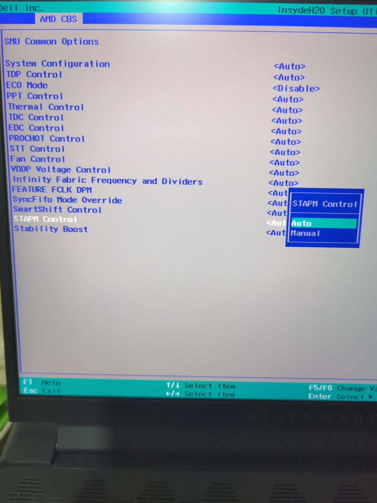
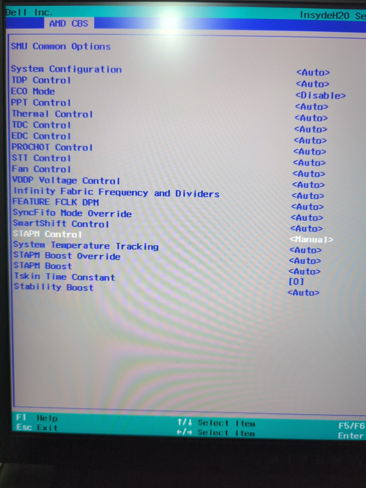

# How I fixed STAPM FPS drops on my Alienware m16 R1 AMD

**My system: Ryzen 9 7845HX · BIOS 1.25.0.** I have not tested this configuration on other BIOS versions or models.

The procedure is: **prepare the USB → open AMD CBS → change the STAPM settings → save and test.**

Before starting, check your installed BIOS version and have your BitLocker recovery key available if device encryption is enabled. Disabling STT changes system thermal management; I have not validated long-term chassis temperatures.

## 1. Download the two files

- **[SREP 0.2.4 RUS](https://github.com/Maxinator500/SmokelessRuntimeEFIPatcher-RUS/releases/tag/0.2.4):** download and extract `SREP_024.zip`.
- **[My Dell-specific CFG](../configs/Alienware_m16_R1_AMD_1.25.0_CBS_ENG_LOG.cfg):** download the raw file or take it from this repository's ZIP.

## 2. Prepare the USB

Use a **FAT32** USB drive. Back up its contents before formatting if needed.

1. Find `SmokelessRuntimeEFIPatcher.efi` in the extracted `SREP_024.zip`.
2. **Rename it to `BOOTX64.EFI`.**
3. Put it in **`EFI/BOOT/`** on the USB.
4. Put the **`.cfg` file in the USB root**. Keep only one `.cfg` there.

```text
USB root/
├── EFI/
│   └── BOOT/
│       └── BOOTX64.EFI     ← renamed SmokelessRuntimeEFIPatcher.efi
└── Alienware_m16_R1_AMD_1.25.0_CBS_ENG_LOG.cfg
```

## 3. Boot the USB and open AMD CBS

Restart, press **F12** at the Dell logo and select the **UEFI USB** entry. Launch the USB application, not Dell's BIOS Flash Update.

SREP should apply the patch and open Setup. Navigate to **AMD CBS → SMU Common Options**.

If Secure Boot blocks the application, see [Secure Boot and BitLocker](#secure-boot-and-bitlocker). If the patch fails or AMD CBS does not appear, stop and check [troubleshooting](testing-and-rollback.md#troubleshooting).

## 4. Change the settings, save and test

Record your original values. Set **STAPM Control → Manual** to reveal the remaining fields, then apply:

| Setting | Value |
|---|---|
| STAPM Control | **Manual** |
| System Temperature Tracking | **0 — Disabled** |
| STAPM Boost Override | **1** |
| STAPM Boost | **0** |
| Tskin Time Constant | **0 — unchanged from my original value** |

Leave the other power, fan and thermal controls at their original settings. Choose **Save Changes and Exit**, boot into Windows and test the same game.

**With these settings, my FPS drops disappeared. Changing only STT back to Auto brought them back.**

Saved settings persist after reboot. To undo them, follow the [rollback instructions](testing-and-rollback.md#restore-the-recorded-original-settings); removing the USB alone does not reset them. Restore the original Secure Boot state if you changed it.

---

## Additional information

The steps above are the procedure. The sections below explain compatibility, menu appearance, verification and the limits of my testing.

### Compatibility

| Target | Status |
|---|---|
| m16 R1 AMD, Ryzen 9 7845HX, BIOS **1.25.0** | I opened the menu and the FPS drops disappeared with the settings above |
| Another m16 R1 AMD configuration on 1.25.0 | Not independently tested |
| m18 R1 AMD | Shares the Dell BIOS package family; **not hardware-tested here** |
| Other BIOS versions, Intel models, other Alienware generations | **Not validated; do not apply this configuration** |

Check the installed version in Dell Setup or Windows System Information (`msinfo32`). A matching downloaded recovery image does not prove that the installed firmware matches it. The CFG has no automatic model/version or checksum guard. I do not recommend downgrading the BIOS to follow this guide.

### Secure Boot and BitLocker

If Secure Boot rejects SREP, temporarily disable Secure Boot in firmware settings to permit the unsigned application. Record its original state, prepare for BitLocker recovery first and restore the original state afterward. Do not erase Secure Boot keys, clear the TPM or change the storage-controller mode. Resume BitLocker protection if you suspended it.

Firmware changes can trigger a recovery-key prompt; see [Microsoft's BitLocker guidance](https://support.microsoft.com/en-us/windows/security/encryption/bitlocker-overview). Dell documents F12 in the [m16 R1 AMD boot instructions](https://www.dell.com/support/manuals/en-me/alienware-m16-r1-amd-laptop/alienware-m16r1-amd-service-manual/boot-sequence?guid=guid-c50bed7f-226b-4768-ab61-9725153df132&lang=en-us).

My notes do not record every USB preparation step or my original Secure Boot state. The preparation instructions describe the standard launch route.

### What the menus look like

In the temporary Setup session, AMD CBS replaces the Advance menu slot.



Selecting Manual reveals the fields below. **This photo still shows their original Auto values, not the final workaround settings.** Use the table in step 4 for the values I tested.



### What the settings and patch do

`STT=0` disables System Temperature Tracking. `Override=1` selects the user-specified Boost value, and `Boost=0` is Disabled in the firmware help. I did not isolate the independent contribution of each Boost setting; keeping them at 1 and 0 was insufficient when I retested with STT=Auto. Tskin Time Constant remained at its original 0; do not interpret that value as unlimited.

The CFG opens the menu by changing a loaded image in memory. It does not flash a modified BIOS or apply the STAPM values for you. The menu patch is lost on reboot, while settings saved through Setup can remain in NVRAM. Keep the USB if you need to reopen CBS later. Firmware updates or default resets may alter settings; do not reuse this version-specific CFG on a different BIOS.

For the thermal-policy explanation, see [why STAPM can limit performance below the CPU temperature limit](problem.md).

### Optional file verification

The CFG contents are byte-identical to the file I tested. `_ENG` in the public filename requests English messages and `_LOG` enables logging, as documented by the [RUS fork](https://github.com/Maxinator500/SmokelessRuntimeEFIPatcher-RUS/tree/0.2.4).

Download the actual raw CFG, not a GitHub HTML page renamed to `.cfg`. It uses ASCII without a BOM and CRLF line endings. Its SHA-256 is:

```text
ec9a9e2eb74d8581573ba4b53f8c8ea04a236f4f8946055b267b7700bdd5bed4
```

From the repository root, with Python 3.10 or newer:

```text
python tools/verify.py
python tools/verify.py --bios /path/to/BIOS_IMG.rcv
```

The first command checks the CFG and packaged evidence. The optional second command also checks the recovery image's exact size and hash. Replace the path with your own and quote it if it contains spaces. Neither command changes firmware. **The recovery image is not needed on the USB.**

### Logs and expected patch results

| Stage | Expected result |
|---|---|
| LoadFromFV / SetupUtilityApp | Success |
| Search/replacement length | `0x30` bytes each |
| Loaded target image size | `0x2720` |
| Match offset | `0x22C0` |
| Patch | Success |
| Exec | Setup opens with AMD CBS available |

The FV lookup may separately show `0x2756`, the FFS body length. These numbers come from offline analysis; I have included photos confirming menu access, but no successful-run text log. If the module differs or the patch fails, do not substitute guessed offsets.

SREP selects the first `.cfg` on its own filesystem volume, which is why the USB root should contain only one. A new run replaces `SREP.log`; save the previous log first if needed. See the fork's [source](https://raw.githubusercontent.com/Maxinator500/SmokelessRuntimeEFIPatcher-RUS/0.2.4/SmokelessRuntimeEFIPatcher/SmokelessRuntimeEFIPatcher.c) and the [BIOS analysis](bios-analysis.md) for implementation details.

### Testing and background

Compare the same game with the same charger, power/fan profile and monitoring setup. Record the time until a drop and, if possible, synchronized frametime and sensor data. CPU temperature alone does not measure chassis or every component's thermal state.

I had replaced Element 31 with PTM7950 before these tests; repasting is not an established prerequisite. RyzenAdj and UXTU did not resolve the issue for me, and I do not have complete logs from those attempts. I also observed a separate stutter issue associated with HWiNFO DELL EC monitoring.

I have not documented a final Auto→0 repeat or long-term thermal validation. See [my screenshots and results](results.md) and [testing, troubleshooting and rollback](testing-and-rollback.md) for the full record.
