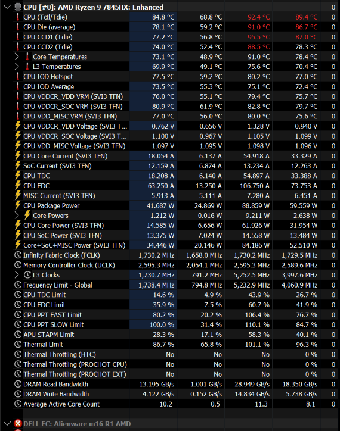
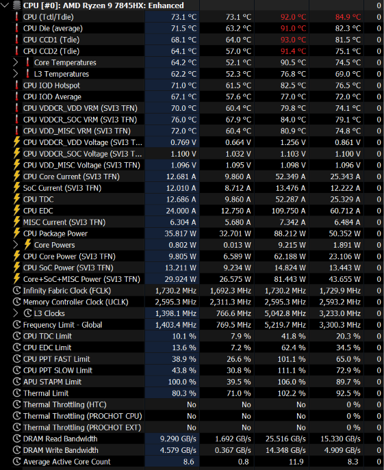

# My results and evidence limits

Documentation prepared: **2026-10-13**. My notes do not include timestamps for the individual test runs.

## My test system

| Item | Recorded information |
|---|---|
| Laptop | Alienware m16 R1 AMD |
| CPU | AMD Ryzen 9 7845HX, visible in HWiNFO |
| BIOS | 1.25.0 |
| Menu access | SREP 0.2.4 RUS with the Dell-specific CFG |
| Thermal interface | I replaced Element 31 with PTM7950 before these tests |
| GPU, game, OS build, fan profile, ambient temperature, run duration | Not included in my test notes |

I did not change the thermal-interface material during this comparison. It does not establish a prerequisite or an explanation for the observed STT behavior.

## What I tested

1. I used a Dell-specific CFG produced through offline BIOS analysis. It substitutes the CBS FormSet GUID into the SetupUtilityApp menu table.
2. I opened AMD CBS → SMU Common Options and photographed the STAPM Control menu.
3. I selected Manual, which revealed System Temperature Tracking, STAPM Boost Override, STAPM Boost and Tskin Time Constant, as predicted by IFR.
4. I applied **Manual / 0 / 1 / 0 / 0** and captured the first HWiNFO screenshot. The FPS drops disappeared.
5. I changed **System Temperature Tracking alone to Auto**, keeping the other listed values unchanged. The FPS drops returned, and I captured the second screenshot.
6. **I have not documented the outcome of a final Auto→0 repeat.**

These are my gameplay observations and sensor screenshots. I am not claiming a measured FPS increase, benchmark score or percentage performance gain.

## A: I disabled STT and the FPS drops disappeared

```text
STAPM Control                Manual
System Temperature Tracking  0
STAPM Boost Override         1
STAPM Boost                  0
Tskin Time Constant          0
```



At the captured moment, STAPM was at 28.3% and PPT SLOW was at 100%. That combination can be consistent with stable operation at a power limit. A limit reaching 100% does not by itself demonstrate a fault or justify increasing it.

## B: I returned STT to Auto and the FPS drops came back

```text
STAPM Control                Manual
System Temperature Tracking  Auto
STAPM Boost Override         1
STAPM Boost                  0
Tskin Time Constant          0
```



At the captured moment, STAPM was at 100%, while PPT FAST, PPT SLOW and Thermal Limit were below 100%. This is consistent with STAPM constraining operation during that snapshot. It does not prove that every FPS drop had that cause or that the sensor policy is faulty.

## Transcribed readings

| Sensor | A current | A maximum | B current | B maximum |
|---|---:|---:|---:|---:|
| APU STAPM Limit (%) | 28.3 | 58.3 | 100.0 | 106.0 |
| CPU PPT FAST Limit (%) | 80.2 | 106.4 | 38.9 | 101.1 |
| CPU PPT SLOW Limit (%) | 100.0 | 101.1 | 43.8 | 111.1 |
| CPU Package Power (W) | 41.687 | 88.859 | 35.817 | 88.212 |
| CPU Tctl/Tdie (°C) | 84.8 | 92.4 | 73.1 | 92.0 |
| CPU Die average (°C) | 78.1 | 91.0 | 71.5 | 91.0 |
| Thermal Limit (%) | 86.7 | 101.1 | 80.3 | 102.2 |
| Frequency Limit — Global (MHz) | 1738.4 | 5232.9 | 1403.4 | 5219.7 |
| HTC / PROCHOT CPU / PROCHOT EXT | No / No / No | No / No / No | No / No / No | No / No / No |

The original screenshot column headings are cropped. Values are transcribed using HWiNFO's standard Current / Minimum / Maximum / Average layout. Only Current and Maximum are copied into this table. A [CSV transcription](../evidence/snapshot-readings.csv) is provided; it is **not a raw sensor log**.

The screenshots were taken at different moments. Their maxima are not simultaneous samples, and the reset times are unknown. Frequency Limit — Global is a limit readout, not a direct measurement of all cores' effective clock. CPU Package Power at one instant is not the configured Slow PPT limit. Thermal Limit exceeded 100% at some earlier point in each capture, even though the shown HTC/PROCHOT maxima remain No; these flags do not establish the absence of all thermal regulation.

## What the comparison supports

- I could access CBS and the STAPM controls on my laptop using the provided CFG.
- The FPS drops disappeared on my laptop with STT=0 and the recorded companion settings.
- When I reverted only STT to Auto, the drops returned and HWiNFO showed a reached STAPM limit.
- Override=1 and Boost=0 alone were insufficient with STT on Auto in my test.

## What it does not establish

- A universal fix for all m16/m18 systems or BIOS releases.
- That STAPM is completely disabled, or that every Dell EC/SMU limit has been bypassed.
- That a particular chassis sensor is defective or reporting a false value.
- The independent necessity of each Boost setting, since those values were held constant in the STT comparison.
- An exact FPS gain, statistically controlled causality or long-term thermal safety.
- Whether another thermal-interface material would produce the same result.

An Auto→0 repeat with synchronized frametime and sensor logging would strengthen my findings. The record above is not a completed three-run A/B/A experiment.

## Separate monitoring issue

Earlier in my troubleshooting, I linked regular stutters to HWiNFO DELL EC monitoring. That is a separate observation on my laptop, not proof that all EC polling is problematic on every Dell system. Keep monitoring behavior consistent when comparing STT settings; polling changes can otherwise confound the result.

I have included my four screenshots without editing them. They contain the BIOS/sensor views used here, not private device identifiers. The BIOS Manual screenshot shows the revealed controls with Auto values, not the final workaround configuration; the final values come from my written setting list.
